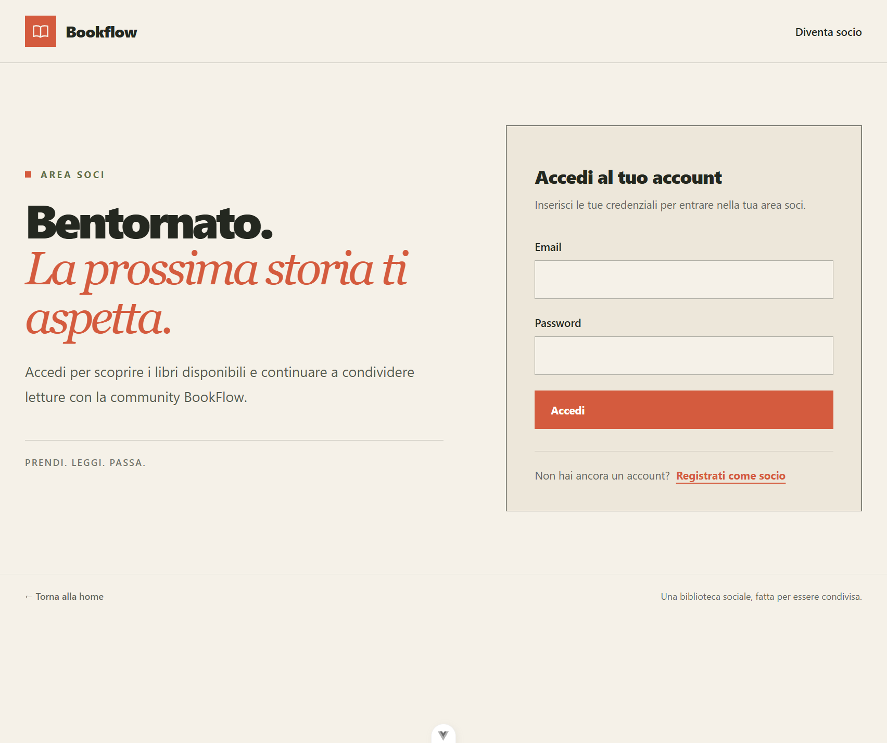

# BookFlow

BookFlow è un'applicazione web per la gestione di una biblioteca sociale. È composta da un'API REST realizzata con Laravel e da una single-page application in Vue3 e TypeScript.

## Funzionalità

- Autenticazione e sessioni per SPA con Laravel Sanctum: registrazione, accesso, uscita e verifica dell'utente corrente.
- Ruoli `admin` e `member`, con accesso alle pagine e alle operazioni in base al ruolo.
- Catalogo di libri con autori, categorie, editori, ISBN, anno di pubblicazione e copertina.
- Ricerca per titolo, ISBN o autore e filtri per categoria e anno; il catalogo dei membri mostra libri con copie disponibili.
- Gestione delle copie fisiche, dei prestiti e dei membri.
- Area amministrativa per gestire libri, copie, categorie e membri; gli utenti possono consultare il catalogo e i propri prestiti e aggiungere libri.
- Test automatici per il backend e test unitari per il frontend.

## Tecnologie

| Area | Tecnologie |
|---|---|
| Backend | PHP 8.3+, Laravel 13, Laravel Sanctum, Spatie Laravel Permission |
| Database | MySQL 8.4 (configurato in Docker Compose tramite Laravel Sail) |
| Frontend | Vue 3, TypeScript, Vue Router, Pinia, Axios |
| UI e build | Tailwind CSS 4, Vite |
| Test | Pest / PHPUnit, Vitest |


## Installazione e avvio

### Prerequisiti

- PHP 8.3 o superiore e Composer
- Docker con Laravel Sail
- Node.js 22.18+ (oppure 24.12+) e npm

### 1. Clona il repository

```bash
git clone https://github.com/Salvo170586SP/BookFlow.git
cd BookFlow
```

### 2. Configura e avvia il backend

```bash
cd BookFlow_api
composer install
cp .env.example .env
```

Nel file `BookFlow_api/.env`, configura l'URL e i parametri MySQL usati dal servizio Sail:

```env
APP_URL=http://localhost
DB_CONNECTION=mysql
DB_HOST=mysql
DB_PORT=3306
DB_DATABASE=bookflow_api
DB_USERNAME=sail
DB_PASSWORD=password
```

Avvia i container, genera la chiave applicativa, crea le tabelle e inizializza i dati:

```bash
./vendor/bin/sail up -d --build
./vendor/bin/sail artisan key:generate
./vendor/bin/sail artisan migrate --seed
./vendor/bin/sail artisan storage:link
```

L'API è disponibile su `http://localhost`; phpMyAdmin è disponibile su `http://localhost:8081`. Il seeder predefinito crea i ruoli `admin` e `member` e un account amministratore locale:

| Email | Password |
|---|---|
| `test@admin.com` | `password` |

Queste credenziali sono solo per lo sviluppo locale: sostituiscile e non riutilizzarle in un ambiente pubblico. Il seeder predefinito non popola il catalogo con libri di esempio.

### 3. Configura e avvia il frontend

In un secondo terminale, dalla directory principale del repository:

```bash
cd BookFlow_web
cp .env.example .env
```

Verifica che `BookFlow_web/.env` contenga:

```env
VITE_API_URL=http://localhost
```

Installa le dipendenze e avvia Vite sulla porta `5174`, autorizzata dalla configurazione CORS del backend:

```bash
npm install
npm run dev -- --port 5174
```

Apri `http://localhost:5174`. Se cambi la porta del frontend, aggiorna anche `allowed_origins` in `BookFlow_api/config/cors.php`.

## Test e build

Test backend:

```bash
cd BookFlow_api
./vendor/bin/sail artisan test
```

Test unitari frontend:

```bash
cd BookFlow_web
npm run test:unit -- --run
```

Per verificare tipi e build del frontend:

```bash
cd BookFlow_web
npm run build
```

## Immagini

Il repository non include screenshot dell'interfaccia. Per aggiungerli, salva le immagini, ad esempio, in `docs/screenshots/` e inseriscile nel README con percorsi relativi:

```markdown




```

Le copertine dei libri caricate dall'applicazione vengono salvate sul disco pubblico di Laravel; `artisan storage:link` crea il collegamento necessario per servirle.

## Ruoli

| Ruolo | Accesso |
|---|---|
| `admin` | Gestione del catalogo, delle copie, delle categorie e dei membri, oltre alle funzioni di prestito. |
| `member` | Consultazione dei libri disponibili, gestione delle proprie richieste/prestiti e inserimento di libri. |

La registrazione pubblica assegna il ruolo `member`; i ruoli disponibili sono definiti dai seeders.

## Autore

**Salvatore** — Full-Stack Developer

- GitHub: [@Salvo170586SP](https://github.com/Salvo170586SP)
